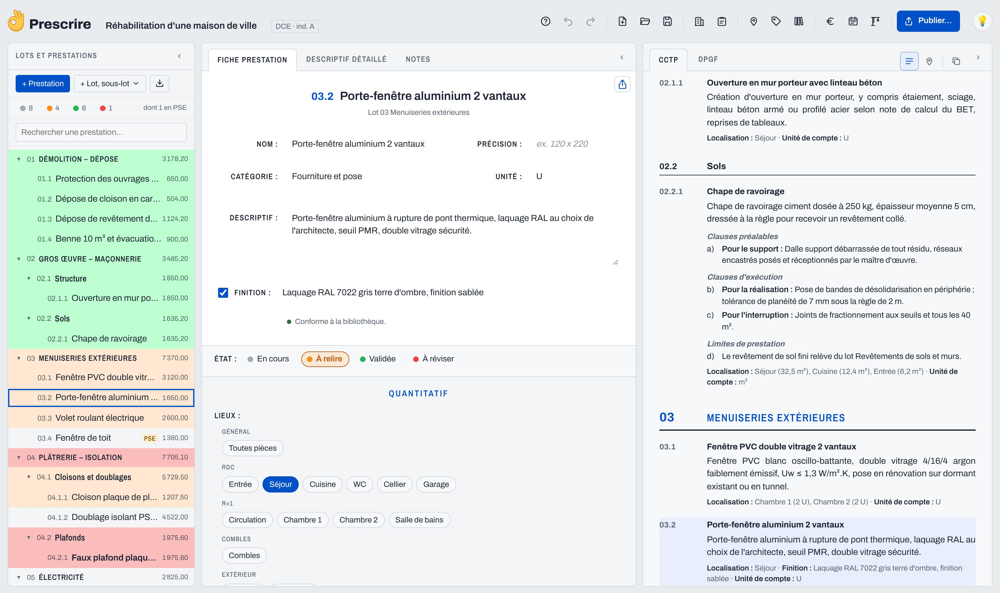
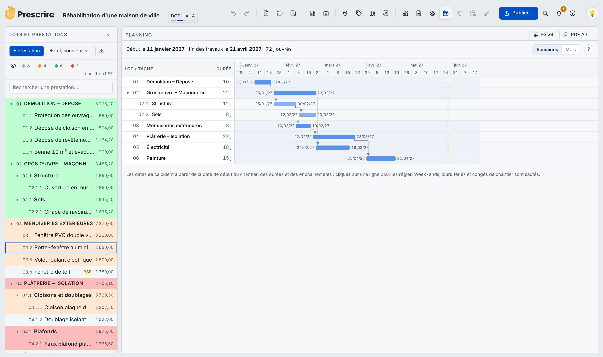
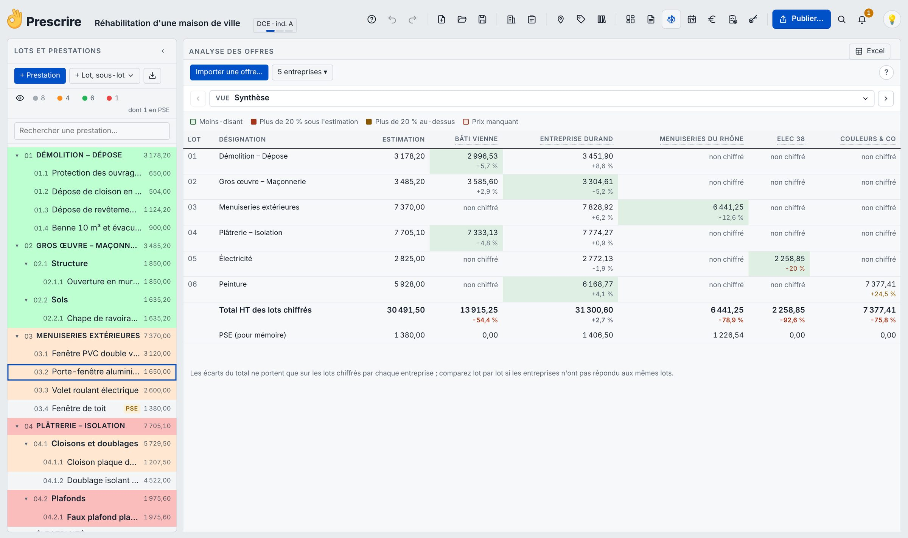
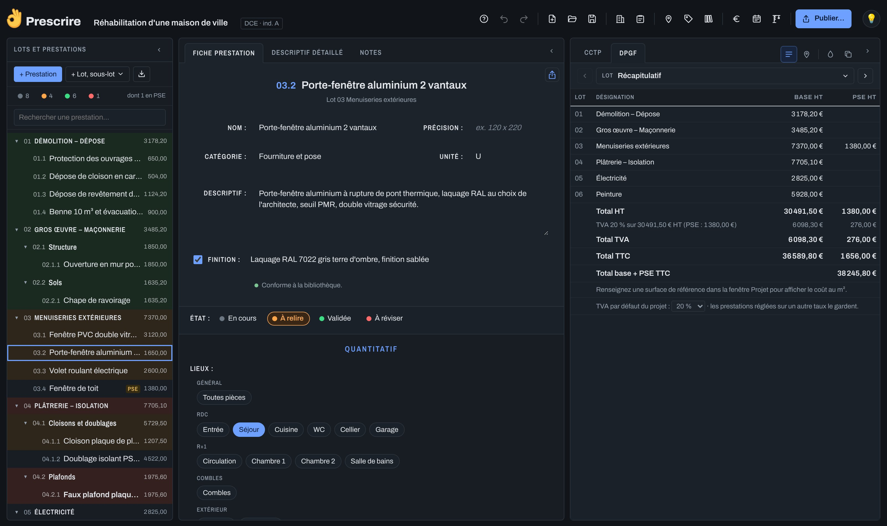
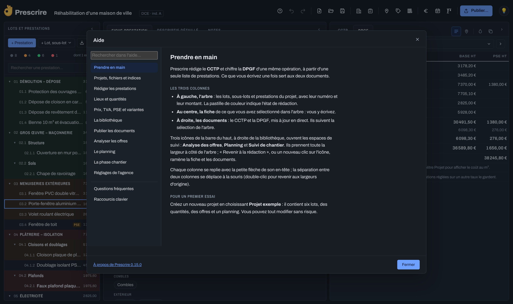

# Prescrire

**Rédaction de CCTP et de DPGF pour les architectes maîtres d'œuvre.** Application de bureau pour macOS et Windows, gratuite et libre.

Prescrire réunit en un seul outil la bibliothèque de prescriptions, le CCTP et la DPGF : les deux documents viennent de la même source et restent toujours cohérents.

## Fonctions

**Rédaction**

- **Lots, sous-lots et prestations** organisés par glisser-déposer, numérotation automatique.
- **Fiche prestation** reliée à une bibliothèque d'articles, avec autocomplétion. Toute nouvelle prestation y est ajoutée.
- **Descriptif détaillé** en clauses (préalables, exécution, limites de prestation), imprimées en alinéas a), b), c)… ; pour chaque lot ou sous-lot, les DTU de référence et des clauses générales imprimées une seule fois.
- **Notes internes** datées et signées, jamais imprimées.
- **État de rédaction** de chaque prestation (en rédaction, à relire, validée, à réviser), visible en couleur dans l'arborescence et reporté sur les lots.
- **Lieux** par niveau, avec surface, périmètre et hauteur. Les quantités acceptent des formules (`P*H-4` pour les murs d'une pièce, ouvertures déduites) et se ventilent par pièce.
- **Bibliothèque partagée** par l'agence, avec repérage et fusion des doublons ; partage d'une fiche ou de la rédaction d'un lot entier.
- **Descriptif détaillé personnalisable** : paragraphes de clauses et intertitres à renommer, déplacer, supprimer ou ajouter.
- **Fiches lot** : DTU et normes de référence, clauses générales et communes d'un lot, tenues à jour dans la bibliothèque et appliquées aux lots des projets.

**Documents**

- **CCTP et DPGF** affichés en direct, par lots ou par lieux, avec un récapitulatif HT / TVA / TTC et des PSE chiffrées à part.
- **Exports** : CCTP en Word ou en PDF ; DPGF en Excel, version maître d'ouvrage avec prix ou version entreprises avec prix unitaires vides et totaux par formules.
- **Modèle Word de l'agence** : votre page de garde, vos en-têtes et vos styles, avec des champs `{projet}`, `{moa}`, `{phase}`… remplis automatiquement.
- **Phases et indices** : de l'esquisse à la réception ; chaque changement de phase fige l'indice en cours, et deux indices se comparent prestation par prestation.
- **Check-list** avant publication et **recherche** au clavier (Cmd+K).
- **Aide intégrée** : manuel, questions fréquentes et raccourcis clavier.

**Suivi**

- **Tableau de bord** : ouvert au lancement, il rassemble les chiffres du projet utiles à sa phase (estimation, ratio, état de la rédaction, répartition, consultation) et la liste de ce qui reste à faire.
- **Analyse des offres** : import des DPGF remplies par les entreprises, comparaison avec l'estimation, moins-disant et écarts signalés ; export en Excel avec une feuille par lot.

**Modules complémentaires** (réservés à une future version commerciale, hors de ce dépôt)

- **Planning** : durées en jours ouvrés, enchaînements entre lots, jours fériés et congés de chantier sautés ; export Excel et PDF A3.
- **Suivi financier du chantier** : marchés figés par lot, avenants, situations de travaux et états d'acompte, décompte général.
- **Comptes rendus de chantier** et **réception des travaux** (réserves, procès-verbaux).

## Aperçu

Les captures du planning et du suivi de chantier montrent des modules complémentaires.

| | |
|---|---|
|  |  |
| **Planning** : durées, enchaînements et dates calculées | **Analyse des offres** : moins-disant en vert, écarts à l'estimation |
|  |  |
| **Suivi de chantier** : TS, alerte de dépassement, avancement | **Mode sombre**, ici avec le récapitulatif de la DPGF |

Les projets s'enregistrent en fichiers `.caz`. L'application fonctionne sans connexion internet.

## Télécharger

Dans la page [**Releases**](../../releases/latest) :

- **Mac** : le fichier `.dmg` (Mac Intel et Apple Silicon, macOS 11 ou plus récent).
- **Windows** : le fichier se terminant par `-setup.exe` (Windows 10 et 11, sans droits administrateur).

L'application n'est pas signée par Apple ni par Microsoft. Au premier lancement :

- **Mac** : macOS refuse de l'ouvrir. Allez dans *Réglages Système › Confidentialité et sécurité* et cliquez sur *Ouvrir quand même*.
- **Windows** : sur l'écran « Windows a protégé votre ordinateur », cliquez sur *Informations complémentaires*, puis *Exécuter quand même*.

La bibliothèque fournie au départ est un exemple : ses textes et ses prix sont indicatifs et doivent être remplacés par les vôtres (*Bibliothèque › Importer depuis Excel*).

## Prescrire BIB

**Prescrire BIB** est le gestionnaire de bibliothèques de Prescrire : une application gratuite à part, pour entretenir la bibliothèque sans projet ouvert. Elle travaille sur la même bibliothèque que Prescrire.

- Toute la bibliothèque rangée par lots et sous-lots, avec la fiche lot en tête de chaque lot.
- État de rédaction de chaque article, articles incomplets (sans descriptif, sans prix, prix à revoir) signalés.
- Rangement et changement d'état de plusieurs articles à la fois.
- Glisser-déposer pour réordonner les articles ou les changer de lot, tri du plus complet au moins complet.
- Aperçu du CCTP à côté de la fiche ; colonnes réglables et masquables.
- Doublons, exports Excel et `.cazb`, export d'un lot en fiches à partager.
- Ouverture d'un autre fichier de bibliothèque sans toucher à celle du poste.

Les fichiers de bibliothèque, recueils et fiches partagées s'enregistrent en `.cazb`, avec leur propre icône : un double-clic les ouvre dans Prescrire BIB. Les anciens fichiers `.json` s'ouvrent toujours.

Les installeurs de Prescrire BIB sont publiés avec ceux de Prescrire, dans la page *Releases* (fichiers « Prescrire.BIB »). Elle est construite à partir du même code (`src/index.html`) par `outils/fabriquer-bib.mjs`.

## Bibliothèque partagée

Dans *Bibliothèque › Changer de dossier…*, choisissez un dossier du serveur de l'agence. La bibliothèque y est enregistrée sous `bibliotheque-prescrire.json`. Chaque article garde la date et l'auteur de sa dernière modification ; quand deux postes écrivent en même temps, les modifications sont fusionnées article par article.

Les projets `.caz` peuvent aussi être rangés sur le serveur : un fichier caché `.nom.caz.verrou` prévient les autres postes qu'un projet est déjà ouvert.

## Organisation du code

- `src/` : l'interface (HTML et JavaScript), avec ses polices et ses modules Excel (ExcelJS) et Word (JSZip) intégrés.
- `src-tauri/` : la coquille de bureau en Rust ([Tauri 2](https://tauri.app)) : fenêtre, fichiers, dialogues, association des fichiers `.caz` (Prescrire) et `.cazb` (Prescrire BIB).
- `.github/workflows/fabriquer.yml` : fabrique les installateurs Mac et Windows à chaque envoi sur `main` et les publie dans *Releases*, sous le numéro de version de `src-tauri/tauri.conf.json`.

Pour publier une nouvelle version, augmentez le numéro dans `src-tauri/tauri.conf.json`, `src-tauri/Cargo.toml` et `package.json`, puis envoyez les modifications sur `main`.

## Licence

Les modules de base de Prescrire sont un logiciel libre, distribué sous licence [GNU GPL version 3](LICENSE) ou toute version ultérieure. Vous pouvez les utiliser, les étudier, les modifier et les redistribuer ; toute version modifiée diffusée doit rester sous la même licence, avec son code source.

Les modules Planning, Suivi financier du chantier, Comptes rendus de chantier et Réception des travaux sont des modules complémentaires, proposés à l'avenir sous licence commerciale, en dehors de ce dépôt ; les versions du planning et du suivi de chantier déjà publiées ici restent sous GPL. Le tableau de bord et l'analyse des offres font partie des modules libres. Les modules de base n'ont pas vocation à être commercialisés pour le moment. Détails dans [LICENSING.md](LICENSING.md).

Ce logiciel est fourni sans aucune garantie. Les prescriptions et les prix produits restent sous la responsabilité de leur auteur.
